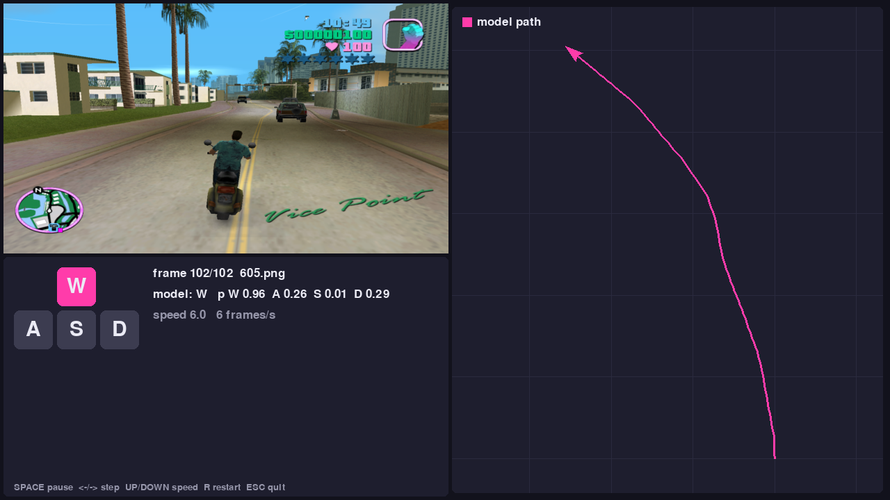

# Vice City Autopilot

Predicts which driving keys (**W A S D**) a player is holding from a single GTA Vice City screenshot, then uses those predictions to drive a car in a pygame simulation.



## How it works
1. **Cleaned the data.** Removed 50 junk images (Michael Jackson photos, screenshots from other GTA games) and repaired 8 broken file links. That left 408 real gameplay frames.
2. **Extracted features.** A pretrained EfficientNet-B0 looks at the whole frame and at a close-up crop of the car.
3. **Classified the keys.** Two small classifiers decide *forward / brake / none* and *left / right / none*, so impossible combinations like W+S never happen.
4. **Used a mirror trick.** Flipping an image swaps left and right, which doubles the steering training data.
5. **Simulated the drive.** Each frame's predicted keys drive a car on a top-down map. Steering is smoothed over neighbouring frames, and the map auto-zooms to follow the route.

## Quick start
```bash
pip install -r requirements.txt

# run the simulation on a folder of frames (or a video file)
python simulate.py --images path/to/frames

# just get predictions as a CSV
python predict.py --images path/to/frames --out predictions.csv

# retrain (needs the dataset folder with train.csv and train_images/)
python train.py --data path/to/dataset
```
**Simulation controls:** `SPACE` pause · `←/→` step · `↑/↓` speed · `R` restart · `ESC` quit

## Results
Scored with 5-fold cross-validation, so every frame is predicted by a model that never saw it.

| | This model | Always press W |
|---|---|---|
| Route end-point error | **12.8%** | 20.7% |
| Macro-F1 (W/A/S/D) | **0.36** | 0.23 |

Predicting keys from a single still frame is hard, and braking (S) is rarely caught.
Full details and stress tests are in [REPORT.md](REPORT.md).

## Files
| File | What it does |
|---|---|
| `simulate.py` | pygame simulation |
| `predict.py` | predictions to a CSV |
| `train.py` | data cleaning + training |
| `common.py` | shared model code |
| `model.pt` | trained model (8 MB) |
| `tests/` | stress tests and evaluation |

Built for the DataQuest Hackathon, Round 2 ([dataset](https://github.com/123MRaahimRizwan/DATA-QUEST-R02-SDC-GTA-VICE-CITY)).
